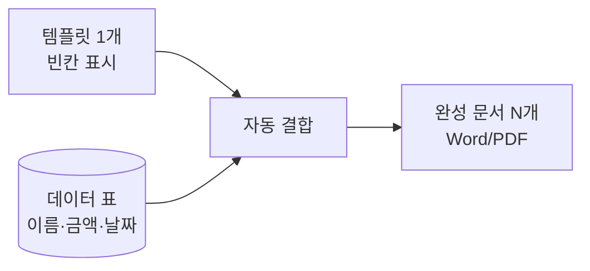

> 🏷️ **[탐라야행_Automation_Solution]** · 주식회사 탐라야행 정식 업무 자동화 솔루션
{: .prompt-tip }

> "이름·금액만 다르고 양식은 똑같은" 문서를 수십·수백 장 손으로 만들고 계신가요? 계약서·안내문·증명서·견적서… 이건 **데이터 + 템플릿**으로 1분에 끝납니다.
{: .prompt-info }

## 🧩 원리 — "템플릿 + 데이터 = 완성 문서"



이른바 **메일 머지(Mail Merge)** 의 확장입니다. 빈칸(`{이름}`, `{금액}`)이 있는 템플릿에 표의 각 행을 채워 문서를 찍어냅니다.

## 🛠️ 방법 (난이도별)

| 방법 | 도구 | 적합 |
|------|------|------|
| **워드 편지 병합** | MS Word + 엑셀 | 코딩 0, 소량 |
| **파이썬 자동화** | `python-docx` · `openpyxl` | 대량·반복·조건부 |
| **PDF 변환·발송** | + PDF 변환 + 메일/문자 | 생성 후 자동 발송까지 |

```python
# 예: 표의 각 행으로 계약서 자동 생성
from docx import Document
for row in rows:
    doc = Document("계약서_템플릿.docx")
    for p in doc.paragraphs:
        p.text = p.text.replace("{이름}", row["이름"]).replace("{금액}", row["금액"])
    doc.save(f"계약서_{row['이름']}.docx")
```


## 🪤 위 코드의 함정 — 서식이 사라지는 문제

`p.text = p.text.replace(...)` 방식은 간단하지만 두 가지 문제가 있습니다.

1. **서식 손실**: 문단의 텍스트를 통째로 다시 쓰면 굵게·글꼴·색 같은 **서식이 첫 서식으로 합쳐지거나 사라집니다.**
2. **치환 누락**: 워드는 `{이름}`을 입력할 때 내부적으로 `{`, `이름`, `}`를 서로 다른 조각(run)으로 나눠 저장하는 경우가 있어, 문단 전체를 문자열로 바꾸면 맞지만 조각 단위로 바꾸면 안 맞습니다.

실무에서는 보통 둘 중 하나를 씁니다.

| 방법 | 장점 | 주의 |
|------|------|------|
| **템플릿 엔진 라이브러리**(예: `docxtpl`) | 워드 템플릿에 `{{ 이름 }}`을 쓰고 서식을 그대로 유지, 반복·조건 문단도 가능 | 템플릿 작성 규칙을 익혀야 함 |
| **조각(run) 단위 치환** | 의존성이 적음 | 플레이스홀더가 조각에 걸치면 합치는 처리가 필요 |

```python
# docxtpl 예시 — 서식은 워드에서, 값만 코드에서
from docxtpl import DocxTemplate

for row in rows:
    tpl = DocxTemplate("계약서_템플릿.docx")        # 안에 {{ 이름 }}, {{ 금액 }} 사용
    tpl.render({"이름": row["이름"], "금액": f'{row["금액"]:,}원'})
    tpl.save(f"out/계약서_{row['사번']}_{row['이름']}.docx")
```

금액은 `f'{값:,}'`처럼 **자리 구분 쉼표**를 코드에서 넣고, 날짜는 `2026년 7월 3일` 같은 표기 규칙을 한 곳에서 정해 두면 100장이 모두 같은 형식으로 나옵니다.

## 📄 PDF로 만들고 한꺼번에 묶기

- Word 파일을 **PDF로 변환**하면 받는 사람 환경에 따라 서식이 깨지는 일을 막을 수 있습니다. 서버나 PC에 LibreOffice가 있다면 명령줄(`soffice --headless --convert-to pdf`)로 폴더 단위 변환이 가능합니다.
- 파일명은 `계약서_{사번}_{이름}.pdf`처럼 **사번 같은 고유값**을 넣어 동명이인 덮어쓰기를 막습니다.
- 발송이 필요하면 생성이 모두 끝난 **뒤에** 별도 단계로 분리해, 검수 없이 나가는 일이 없게 합니다.

## ✅ 대량 생성 전 검수 절차

1. **샘플 5장 먼저**: 첫 행, 마지막 행, 이름이 가장 긴 행, 금액이 가장 큰 행, 값이 비어 있는 행으로 만들어 눈으로 확인합니다.
2. **개수 대조**: 입력 행 수 = 생성 파일 수인지 자동으로 비교합니다.
3. **빈칸 탐지**: 결과 문서에 `{{`나 `}}`가 남아 있으면 치환이 빠진 것이므로 실패로 처리합니다.
4. **생성 기록 남기기**: 어떤 데이터 파일로 몇 시에 몇 장을 만들었는지 로그를 남기면, 문서에 문제가 생겼을 때 원인을 바로 찾을 수 있습니다.


## 💡 이런 데 효과적

- 📄 **계약서·근로계약서** 대량 발급
- 🧾 **견적서·거래명세서·인보이스**
- 🎓 **수료증·증명서·상장**
- 🏷️ **주소 라벨·명찰·초대장**

## ⚠️ 체크 포인트

- **원본 데이터 검증 먼저** — 잘못된 데이터 = 잘못된 문서 100장 ([데이터 클렌징]())
- **개인정보 보관·파기** 정책 준수
- **최종본 사람 확인** — 특히 금액·법적 효력 문서는 표본 검수

> 📉 **도입 효과 한 줄 요약 (예시 ROI)** — 계약서·안내문을 1건당 5분씩 **100장 손수 작성 = 약 8시간**이 자동 생성으로 **1분 미만**. 발급 성수기 기준 담당자 **월 수십 시간** 회수 + 오타·금액 오기입 리스크 제거.
> *(예시 기준이며 문서량·양식에 따라 다릅니다.)*
{: .prompt-tip }

## 📩 반복 문서, 찍어내게 만들어드립니다

양식 1개와 데이터 예시만 주시면 자동 생성 방안을 진단해 드립니다.
→ [Business Inquiry]() · [200gyu@gmail.com](mailto:200gyu@gmail.com)

> 관련 → [파이썬 엑셀 자동화]() · [노코드 자동화]()
{: .prompt-info }


---

> 📎 본 글은 **주식회사 탐라야행 기술연구소**의 R&D 자산입니다.
> **함께 읽기** — [⚡ 자동화 대표 사례]() · [📖 블로그 안내]() · [📩 비즈니스 문의]()
{: .prompt-info }
