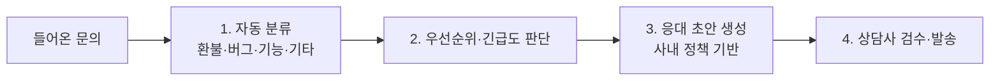

> 🏷️ **[탐라야행_AX_Solution]** · 주식회사 탐라야행 정식 AX 솔루션 라인업
{: .prompt-tip }

> 문의는 매일 쌓이는데, **분류하고 → 담당 배정하고 → 비슷한 답을 또 쓰는** 일에 CS 팀 시간이 녹습니다. AI가 앞단을 처리하면 사람은 **판단·공감**에 집중할 수 있습니다.
{: .prompt-info }

## 🔁 흐름



## 🧭 3가지 핵심 기능

**1. 자동 분류(태깅)**
문의를 사전 정의 카테고리로 즉시 분류 → 담당팀 자동 배정, 통계 자동화.

**2. 감정·긴급도 파악**
화난 고객·이탈 위험 신호를 우선순위로 올려 **놓치지 않게**.

**3. 응대 초안 생성**
사내 정책·FAQ를 근거로 **답변 초안**을 만들어 상담사가 다듬어 발송. (근거 문서 활용 → [RAG]())

## 📊 무엇이 좋아지나

| | Before | After |
|---|--------|-------|
| 분류·배정 | 수기 | **자동** |
| 첫 응답 속도 | 지연 | **초안 즉시** |
| 반복 답변 | 매번 작성 | **초안 재사용** |
| 상담사 역할 | 단순 응대 | **판단·공감** |

## ⚠️ 반드시 지킬 것

- **자동 발송 금지(초기엔)** — AI 초안은 **사람이 검수 후** 발송. 오답·무례 방지
- **개인정보 최소화** — 문의 속 개인정보 처리·보관 정책 준수
- **분류 정확도 평가** — 대표 문의로 정기 점검·개선

## 🏷️ 분류 체계는 이렇게 설계합니다

AI보다 **분류 체계**가 먼저입니다. 체계가 흐리면 어떤 모델도 흔들립니다.

| 대분류 | 세부 예시 | 보통 맡는 팀 |
|--------|-----------|--------------|
| 결제·환불 | 결제 오류, 환불 요청, 영수증 | 정산·CS |
| 배송·이용 | 지연, 오배송, 예약 변경 | 운영 |
| 사용법·오류 | 로그인 불가, 화면 오류 | 개발·CS |
| 기능 제안 | 신규 기능, 개선 요청 | 기획 |
| 칭찬·기타 | 감사, 일반 문의 | CS |

설계 원칙은 세 가지입니다.
- **서로 겹치지 않게**: 한 문의가 두 칸에 걸치면 "주된 요청 하나"를 고르는 규칙을 정합니다.
- **담당자 기준으로 나누기**: 분류가 곧 배정이 되도록, 팀이 실제로 나뉜 방식 그대로 만듭니다.
- **'기타'는 10% 이하로**: 기타가 커지면 새 카테고리가 필요하다는 신호입니다.

## 🧾 분류 프롬프트 예시

결과를 **정해진 형식(JSON)** 으로 받으면 시스템 연결이 쉽습니다.

```text
너는 고객 문의 분류 담당자야. 아래 문의를 읽고 JSON으로만 답해.
- category: 결제·환불 / 배송·이용 / 사용법·오류 / 기능 제안 / 칭찬·기타 중 하나
- urgency: 높음 / 보통 / 낮음  (환불·법적 언급·이탈 암시는 '높음')
- sentiment: 화남 / 중립 / 만족
- reason: 판단 근거 한 줄
확신이 낮으면 category를 "미분류"로 두고 reason에 이유를 적어.

[문의]
"결제가 두 번 됐는데 환불 안 해주시면 소비자원에 신고하겠습니다."
```

이 문의는 **결제·환불 / 높음 / 화남**으로 분류돼야 하고, "신고" 같은 표현은 상담 책임자에게 바로 에스컬레이션하는 규칙과 연결하는 것이 안전합니다.

## 📏 정확도는 이렇게 점검합니다

1. **정답지 만들기**: 과거 문의 100~200건을 담당자가 직접 분류해 둡니다.
2. **AI 결과와 비교**: 맞은 비율과 **어떤 칸끼리 헷갈리는지**(예: 환불 ↔ 배송 지연)를 봅니다.
3. **긴급은 놓치지 않기**: 전체 정확도보다 **긴급 문의를 놓치지 않는 비율**을 더 엄격하게 봅니다. 의심되면 높음 쪽으로 보내는 편이 비용이 작습니다.
4. **정기 재점검**: 신제품·정책 변경 후에는 정답지를 갱신하고 다시 측정합니다.

## 🗓️ 4주 도입 로드맵

| 주차 | 할 일 | 산출물 |
|------|-------|--------|
| 1주 | 문의 샘플 수집, 분류 체계 확정 | 분류표 |
| 2주 | 프롬프트 작성, 정답지로 정확도 측정 | 정확도 리포트 |
| 3주 | 응대 초안 연결(사람 검수 필수) | 시범 운영 |
| 4주 | 대시보드·월간 리포트, 개선 항목 정리 | 운영 체계 |

## 📩 우리 CS에 맞게 만들려면

과거 문의 샘플만 주시면 **분류 체계와 정확도부터** 진단해 드립니다.
→ [Business Inquiry]() · [200gyu@gmail.com](mailto:200gyu@gmail.com)

> 관련 → [프롬프트 기법]() · [에이전트 vs RPA]()
{: .prompt-info }


---

> 📎 본 글은 **주식회사 탐라야행 기술연구소**의 R&D 자산입니다.
> **함께 읽기** — [🤖 AX 대표 사례]() · [📖 블로그 안내]() · [📩 비즈니스 문의]()
{: .prompt-info }
