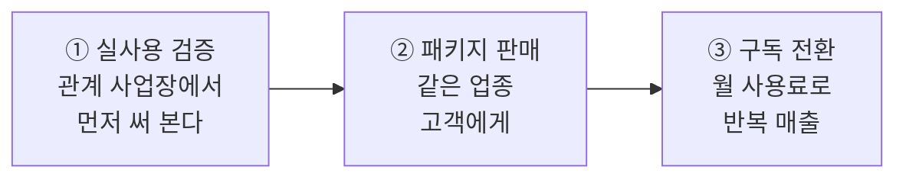

> 탐라야행은 최근 **2026–2027 사업계획서**를 새로 정리했습니다.
> 15장짜리 문서를 그대로 올리기보다, 처음 보는 분도 5분 안에 이해할 수 있게 **핵심만 간추려** 공유합니다.
> 회사의 재무·계약 세부 내용은 대외비라 제외했습니다.
{: .prompt-info }

## 📌 한 줄 요약

> ### 실제로 운영 중인 시스템을 **업종 패키지**로 만들어, **구축 → 유지보수 → 구독**으로 반복 판매한다.
{: .prompt-tip }

| 질문 | 답 |
|---|---|
| **무엇을** | 사내 문서 AI(RAG), 경량 모델(sLLM), 업무 자동화 웹앱, AI 마케팅 콘텐츠 |
| **누구에게** | AI가 필요하지만 대기업 솔루션은 부담스러운 **중소기업** |
| **어떻게** | 검증된 레퍼런스를 업종 패키지로 만들어 **반복 판매** |

## 1️⃣ 문제 — 중소기업의 AI 도입을 막는 세 가지 장벽

| 장벽 | 현실 |
|---|---|
| 💸 **비용** | 대기업형 AI 인프라와 솔루션은 초기 구축비와 월 사용료가 큽니다 |
| 🔒 **데이터 유출 우려** | 고객 정보와 사내 문서를 외부 AI에 올리기 부담스럽습니다 |
| 👤 **전문 인력 부족** | AI를 업무에 연결할 사람이 없어, 결국 엑셀과 단톡방으로 일합니다 |

> **탐라야행의 답** — 필요한 기능만, 합리적인 비용으로, **권한과 보안을 기본값**으로 만든 작은 AI.
{: .prompt-info }

## 2️⃣ 솔루션 — 네 가지 라인업

| 라인업 | 핵심 |
|---|---|
| 🧠 **사내 지식 AI (RAG)** | 매뉴얼·규정을 근거로 답하는 내부 챗봇. 근거 없는 답변을 줄이는 구조 |
| ⚙️ **경량 모델 (sLLM)** | 오픈소스 경량 모델을 업종 데이터로 미세조정. 민감 데이터는 내부에서 처리 |
| 🖥️ **업무 자동화 웹앱** | 배정·정산·결산 같은 반복 업무를 웹앱으로. 역할별 권한·엑셀 연동 포함 |
| 📣 **AI 마케팅·콘텐츠** | 블로그·숏폼·SNS 콘텐츠 제작과 문의 전환 분석 |

## 3️⃣ 첫 레퍼런스 — 실제로 돌아가는 시스템

설립 1주일 만에 첫 AI 솔루션 계약을 맺었고, 그 결과물이 탐라야행의 첫 레퍼런스가 됐습니다.

**파트너스 매칭 매니저** — 프리랜서 수십 명 규모 기업의 현장 배정·급여·인력 관리 시스템

| 기능 | 내용 |
|---|---|
| 역할별 권한 | 관리자·매니저·파트너 화면 분리, 행 수준 보안 |
| 배정 관리 | 중복 배정 방지, 상태 추적, 달력 보기 |
| 급여·정산 | 데이터 유실을 막는 원자적 저장, 지급 상태, 엑셀 명세서 |
| 보안 점검 | 공개 키로 데이터가 노출되던 정책 구멍을 찾아 차단 |

개발 과정은 [파트너스 매칭 매니저 시리즈]()에서 모두 공개하고 있습니다.

## 4️⃣ 목표 고객과 검증 순서

| 업종 | 패키지 |
|---|---|
| 인력 매칭·생활서비스 | 프리랜서 배정·정산 관리 |
| 외식 가맹점 | 일일 결산·POS·배달 정산·인건비 관리 자동화 |
| 제조·일반 중소기업 | 사내 문서 AI, 도면·데이터 분석, 반복 사무 자동화 |

## 5️⃣ 수익 모델 — 구축에서 반복 매출로

| 단계 | 형태 |
|---|---|
| **구축** | 업종 패키지 설치 + 맞춤 개발 (프로젝트) |
| **유지보수** | 하자보수 이후의 운영·개선 (월 단위) |
| **구독(SaaS)** | 패키지를 월 사용료로 제공 |
| **마케팅 대행** | 블로그·숏폼·SNS 운영 (월 정액) |

> 단건 프로젝트만으로는 성장이 끊깁니다. 그래서 **유지보수·구독 비중을 늘리는 것**이 계획의 중심입니다.
{: .prompt-tip }

## 6️⃣ 2027 목표와 로드맵

| 지표 | 2027 목표 |
|---|---|
| 연 매출 | **3억 원** |
| 신규 채용 | **2명** (AI 개발 1명, 디자인 1명) |
| 외부 고객 | **3곳 이상** (상반기) |
| 유지보수·구독 | **20개 사업장** (하반기) |

| 2026 Q4 | 2027 Q1 | 2027 Q2 | 2027 H2 | 2028 |
|:---:|:---:|:---:|:---:|:---:|
| 첫 납품 완료 | 패키지 1호 | 외부 고객 확대 | 구독 전환 | sLLM 상품화 |

진행 상황은 이 블로그에서 꾸준히 공유하겠습니다.

## 7️⃣ 리스크도 숨기지 않습니다

| 리스크 | 대응 |
|---|---|
| **초기 매출처 집중** | 2027년 상반기까지 외부 고객을 늘려 매출처를 분산 |
| **소수 인력** | 정부 고용 지원을 활용해 개발 인력 채용 |
| **범용 AI의 빠른 발전** | 업종 데이터와 현장 업무 연결에 집중해 정면 경쟁을 피함 |
| **초기 자금 규모** | 낮은 고정비 유지, 선금 지급 계약 구조 |

## 🧭 마치며

사업계획서는 약속입니다. 탐라야행은 이 계획을 **분기마다 블로그에서 점검**하겠습니다. 잘된 것과 안 된 것을 모두 공개하는 것, 그것이 작은 회사가 신뢰를 쌓는 방법이라고 믿습니다.

> **주식회사 탐라야행** — 작게 시작해, 현장에 붙는 AI.
{: .prompt-tip }

---

> 📎 본 글은 **주식회사 탐라야행 기술연구소**의 R&D 자산입니다.
> **함께 읽기** — [🏢 대표 사례 & 기술 스택]() · [🎯 미션·비전·핵심가치]() · [📩 비즈니스 문의]()
{: .prompt-info }
