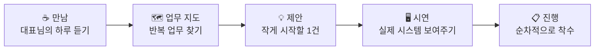

> 안녕하세요, 탐라야행 대표이사 **이경규**입니다.
> 오늘은 지난 두 달 동안 제가 **개인적으로 어떻게 지냈는지** 짧게 적어 보려 합니다.
{: .prompt-info }

## 🚶 한 줄 근황

**"키보드보다 사람을 더 많이 만난 두 달이었습니다."**

7월에는 거의 매일 블로그에 글을 올렸습니다. 그러다 8월부터는 글이 뜸해졌습니다. 게을러서가 아니라, 글보다 먼저 해야 할 일이 생겼기 때문입니다.

## 🤔 왜 현장으로 나갔나

블로그에 기술 글을 100편 넘게 쌓고 나니 질문이 하나 남았습니다.

> **"이 글을 읽어야 할 대표님들은, 지금 무엇 때문에 밤잠을 설치고 있을까?"**
{: .prompt-tip }

책상 앞에서는 답이 나오지 않았습니다. 중소기업의 AI 도입은 기술 문제이기 전에 **사람과 현장의 문제**라고 생각합니다. 그래서 직접 가서 듣기로 했습니다.

## 🤝 두 달 동안 한 일

탐라야행의 대표이사로서 **여러 사업체의 대표님들을 직접 만나고, 제가 가진 인적·물적 인프라를 모두 동원해 기술 영업에 전념**했습니다.

| 무엇을 | 어떻게 |
|---|---|
| **대표님 미팅** | 업종과 규모를 가리지 않고 찾아가, 회사의 하루가 어떻게 돌아가는지부터 들었습니다 |
| **네트워크 총동원** | ICT 엔지니어 시절부터 법인 경영까지 10년 넘게 쌓은 인연을 하나하나 다시 찾아갔습니다 |
| **현장 진단** | "AI로 뭘 할 수 있나요?"라는 질문에 업무 흐름을 같이 그려 보며 답했습니다 |
| **실물 시연** | 말 대신, 실제로 운영 중인 업무 자동화 시스템을 화면으로 보여 드렸습니다 |

## 👂 현장에서 반복해서 들은 이야기

대표님들의 업종은 달랐지만, 고민은 놀랄 만큼 비슷했습니다.

1. **"AI가 필요한 건 아는데, 어디서부터 시작해야 할지 모르겠다."**
2. **"결국 엑셀이랑 단톡방으로 다 돌아간다."** — 사람이 바뀌면 일도 멈춥니다.
3. **"회사 자료를 밖에 올려도 괜찮은지 걱정된다."** — 보안은 늘 첫 질문이었습니다.

> 이 세 가지는 탐라야행이 풀어야 할 숙제이자, 앞으로 블로그에서 다룰 이야기의 출발점입니다.
{: .prompt-info }

## 📝 제가 배운 세 가지

| 배운 점 | 한 줄 정리 |
|---|---|
| **기술보다 언어** | "RAG"보다 "우리 회사 규정집을 아는 비서"가 먼저 통합니다 |
| **크게보다 작게** | 전사 도입보다 귀찮은 업무 하나를 먼저 없애 드리는 게 신뢰를 만듭니다 |
| **설명보다 시연** | 백 마디 제안서보다 실제로 돌아가는 화면 하나가 낫습니다 |

## 🙇 마치며

블로그를 기다려 주신 분들께는 죄송한 마음입니다. 대신 현장에서 직접 듣고 확인한 이야기들을 이제부터 하나씩 풀어 놓겠습니다.

앞으로의 계획은 정리되는 대로 다음 글에서 말씀드리겠습니다. 탐라야행이 그리는 큰 그림은 [사업계획서 요약]()에서 먼저 보실 수 있습니다.

> **주식회사 탐라야행** — 현장에서 듣고, 작게 만들고, 끝까지 함께합니다.
{: .prompt-tip }

---

> 📎 본 글은 **주식회사 탐라야행** 대표이사의 근황 기록입니다.
> **함께 읽기** — [🏢 대표 사례 & 기술 스택]() · [📖 블로그 안내]() · [📩 비즈니스 문의]()
{: .prompt-info }
