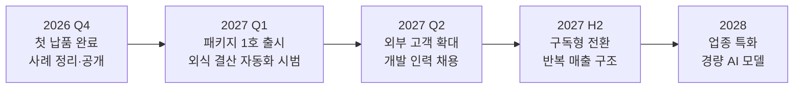

> 지난 몇 달, 현장에서 [여러 대표님을 만나며]() 확인한 것이 있습니다.
> **중소기업에 필요한 건 거대한 AI가 아니라, 내일 아침 업무에 바로 붙는 작은 AI**라는 사실입니다.
> 이 글은 그 확신을 바탕으로 세운 넥스트엑스의 **다음 1년 계획**입니다.
{: .prompt-info }

## 🎯 우리의 포부

> ### "작게 시작해, 현장에 붙는 AI."
{: .prompt-tip }

넥스트엑스는 **중소기업이 감당할 수 있는 비용으로, 현장 업무에 바로 쓰이는 AI**를 만드는 회사가 되려 합니다. 범용 AI와 기능 경쟁을 하기보다 **업종의 데이터와 현장의 업무 흐름**을 연결하는 데 집중합니다.

## 🧱 세 가지 원칙

| 원칙 | 의미 |
|---|---|
| **① 검증된 것만 판다** | 실제로 운영해 본 시스템을 먼저 만들고, 그다음에 고객에게 권합니다 |
| **② 업종으로 묶는다** | 한 번 만든 시스템을 같은 고민을 가진 업종에 패키지로 공급합니다 |
| **③ 끝까지 함께한다** | 구축으로 끝내지 않고 유지보수·구독으로 운영을 책임집니다 |

## 🗺️ 2027 로드맵

| 시기 | 무엇을 | 목표 |
|---|---|---|
| **2026 Q4** | 첫 프로젝트 검수 완료, 사례를 익명으로 정리해 공개 | 레퍼런스 확보 |
| **2027 Q1** | **인력 매칭·정산 관리 패키지** 1호 출시, 외식업 일일 결산 자동화 시범 운영 | 패키지화 |
| **2027 Q2** | 같은 업종의 외부 고객 계약 확대, AI 개발 인력 채용 | 외부 고객 3곳 |
| **2027 H2** | 유지보수·구독(SaaS) 전환으로 반복 매출 구조 구축 | 연 매출 3억 원 |
| **2028** | 업종 데이터로 미세조정한 **경량 AI 모델(sLLM)** 상품화, 데이터 보안형 상품 | 기술 고도화 |

> 위 수치는 넥스트엑스의 **목표**이며, 진행 상황은 이 블로그에서 투명하게 공유하겠습니다.
{: .prompt-warning }

## 🎯 집중할 고객

| 업종 | 넥스트엑스가 풀 문제 |
|---|---|
| **인력 매칭·생활서비스** (정리수납·청소·이사 등) | 프리랜서 배정, 일정 충돌, 급여 정산을 한 화면에서 |
| **외식 가맹점** | POS·배달앱·카드 매출을 모아 매일 손익을 자동으로 |
| **제조·일반 중소기업** | 사내 문서를 아는 AI 비서, 반복 사무 자동화 |

## ✍️ 블로그도 이렇게 바뀝니다

- **주 2회(화·목) 정기 발행**으로 다시 시작합니다.
- 기술 설명에 그치지 않고, **대표님이 의사결정에 바로 쓸 수 있는 글**을 늘리겠습니다.
- 고객 사례는 **비밀유지 원칙**에 따라 익명화해 소개합니다.

## 🙏 마치며

설립 4개월 차의 작은 회사가 세우기엔 큰 계획일 수 있습니다. 그래도 한 걸음씩, 현장에서 검증하면서 가겠습니다. 이 여정을 지켜봐 주시고, 함께하고 싶은 분은 언제든 연락 주세요.

→ [Business Inquiry]() · [csnextx@gmail.com](mailto:csnextx@gmail.com)

> **주식회사 넥스트엑스(NEXT X)** — 작게 시작해, 현장에 붙는 AI.
{: .prompt-tip }

---

> 📎 본 글은 **주식회사 넥스트엑스(NEXT X) 기술연구소**의 R&D 자산입니다.
> **함께 읽기** — [🎯 미션·비전·핵심가치]() · [🤝 일하는 방식]() · [📩 비즈니스 문의]()
{: .prompt-info }
