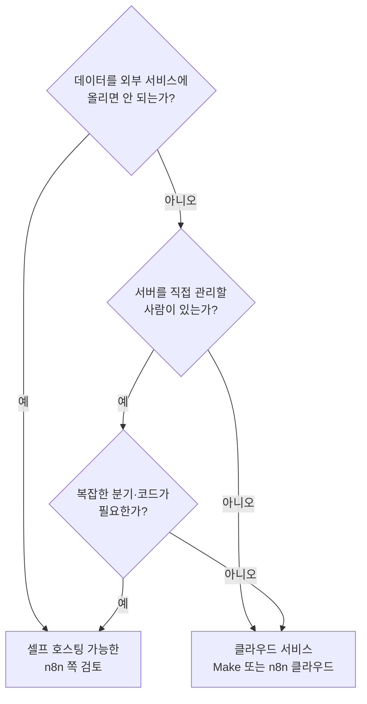

> 🏷️ **[탐라야행_Automation_Solution]** · 주식회사 탐라야행 정식 업무 자동화 솔루션
{: .prompt-tip }

> "노코드 자동화 도구, 뭘 써야 하나요?" 상담에서 자주 받는 질문입니다. 이 글은 **n8n**과 **Make** 두 도구를 어떤 기준으로 비교하면 되는지 정리합니다. 요금과 기능은 자주 바뀌므로 **구체적인 가격은 적지 않았고**, 도입 전에 각 공식 사이트의 최신 요금 안내를 꼭 확인하세요.
{: .prompt-info }

## 먼저, 두 도구는 무엇이 다른가

둘 다 "앱과 앱을 연결해 업무를 자동으로 흘려보내는" 도구입니다. 화면에서 블록(노드·모듈)을 이어 붙여 흐름을 만든다는 점은 같습니다. 차이는 **어디서 돌아가고, 어떻게 과금되고, 얼마나 깊게 손댈 수 있는가**에 있습니다.

| 기준 | n8n | Make |
|------|-----|------|
| 실행 위치 | 클라우드 서비스 이용 또는 **직접 서버에 설치(셀프 호스팅) 가능** | **클라우드 서비스 이용**(SaaS) |
| 데이터 통제 | 셀프 호스팅 시 데이터가 우리 서버에 머무름 | 데이터가 서비스 운영사 인프라를 거침 |
| 과금 방식(큰 틀) | 클라우드는 워크플로 실행 횟수 기준, 셀프 호스팅은 서버 비용 | 작업(operation) 단위로 쓰인 만큼 차감 |
| 코드 확장 | 코드 노드로 자바스크립트·파이썬 직접 작성 가능 | 내장 함수와 수식 중심, 필요 시 HTTP 호출로 확장 |
| 시작 난이도 | 개념(노드·데이터 흐름)을 익히는 시간이 필요 | 화면이 직관적이라 처음 만들기 쉬운 편 |
| 연동 범위 | 주요 서비스 커넥터 + HTTP 요청 | 커넥터 라이브러리가 넓음 + HTTP 요청 |

> 표는 **일반적인 특징**을 정리한 것입니다. 라이선스 조건, 요금제, 제한은 수시로 바뀌므로 도입 시점의 공식 문서가 기준입니다.
{: .prompt-warning }

## 고르는 질문 5가지

1. **데이터가 어디에 머물러야 하나요?** 고객 정보, 직원 급여, 계약 자료처럼 외부에 두기 부담스러운 데이터가 흐른다면 셀프 호스팅이 가능한 쪽이 유리합니다. 다만 서버 보안·백업·업데이트는 우리 책임이 됩니다.
2. **관리할 사람이 있나요?** 셀프 호스팅은 "무료"가 아니라 **사람의 시간으로 치르는 비용**입니다. 전담이 없다면 클라우드가 현실적입니다.
3. **얼마나 복잡한가요?** 단순한 "A가 오면 B에 기록" 정도면 어느 쪽이든 충분합니다. 조건 분기가 많거나 데이터를 가공하는 코드가 필요하면 코드 노드가 있는 쪽이 편합니다.
4. **한국 서비스와 이어야 하나요?** 카카오 알림톡, 네이버 계열 서비스, 국내 ERP·회계 프로그램은 두 도구 모두 기본 커넥터가 없는 경우가 많습니다. 이럴 때는 해당 서비스의 **API나 웹훅을 HTTP 요청으로 호출**하는 방식으로 연결합니다. 이 부분은 도구 비교보다 "그 서비스가 API를 공개하는가"가 더 중요합니다. ([웹훅이란?]())
5. **실행량이 얼마나 되나요?** 하루 수십 번이라면 어디든 무난하지만, 수천 번 이상 도는 흐름은 과금 구조가 총비용을 좌우합니다. "건당 몇 개의 작업이 쓰이는가"를 먼저 계산해 보세요.

## 같은 업무를 두 도구로 만든다면

**예시: 월말 정산 파일이 올라오면 담당자에게 알림 + 요약 기록**

| 단계 | 하는 일 |
|------|---------|
| 1. 트리거 | 공유 폴더에 새 엑셀 파일 생성 |
| 2. 읽기 | 파일의 합계 행을 읽어 값을 꺼냄 |
| 3. 검증 | 합계가 0이거나 전월 대비 20% 넘게 차이 나면 "확인 필요" 표시 |
| 4. 기록 | 구글시트의 정산 이력 표에 한 줄 추가 |
| 5. 알림 | 담당자에게 메신저·메일로 요약 전달 |

Make에서는 이 흐름을 **모듈 5개를 이은 시나리오**로 만들고, n8n에서는 **노드 5개**로 만듭니다. 3번의 검증처럼 조건이 복잡해질수록 n8n의 코드 노드나 Make의 필터·라우터 같은 기능의 차이가 체감됩니다. 어느 쪽이든 **처음에는 알림까지만 자동화하고 사람이 확인**하는 구조로 시작하세요.

## 흔한 실수

- **도구부터 고르고 업무를 나중에 찾기** — 반복 업무 1건을 먼저 정하고 그에 맞는 도구를 고르는 순서가 맞습니다. ([ROI 계산법]())
- **오류 알림을 만들지 않기** — 연동이 끊겨도 아무도 모르는 자동화가 가장 위험합니다. 실패 시 담당자에게 알려 주는 단계를 반드시 넣으세요. ([자동화가 실패하는 5가지 이유]())
- **계정 하나에 모든 권한 몰아주기** — 자동화용 별도 계정을 만들고 필요한 권한만 주세요.
- **문서화 없이 만든 사람 머릿속에만 두기** — 흐름도 한 장과 담당자, 장애 시 연락처를 남겨 두세요.

## 정리

- **빠르게 만들어 보고 싶고 관리 인력이 없다** → 클라우드 서비스를 이용하는 쪽(Make 또는 n8n 클라우드)
- **데이터 통제가 중요하고 서버를 관리할 수 있다** → 셀프 호스팅이 가능한 n8n
- **어느 쪽이든** → 업무 1건, 알림까지만, 사람이 검수, 오류 알림 필수

더 입문 단계의 개요는 [노코드 자동화 입문]()에서, 시트 중심의 가벼운 자동화는 구글시트 활용 글에서 이어 볼 수 있습니다.

> 우리 회사 업무에는 어떤 도구가 맞을지 **업무 1건만** 알려 주세요. 도구 선택부터 같이 점검해 드립니다. → [Business Inquiry]()
{: .prompt-info }

---

> 📎 본 글은 **주식회사 탐라야행 기술연구소**의 R&D 자산입니다.
> **함께 읽기** — [⚡ 자동화 대표 사례]() · [📖 블로그 안내]() · [📩 비즈니스 문의]()
{: .prompt-info }
